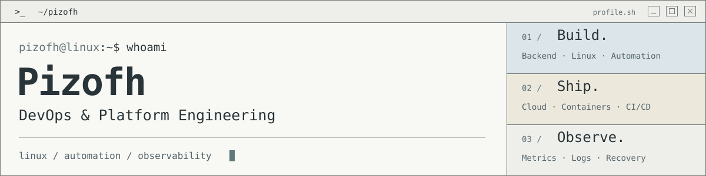
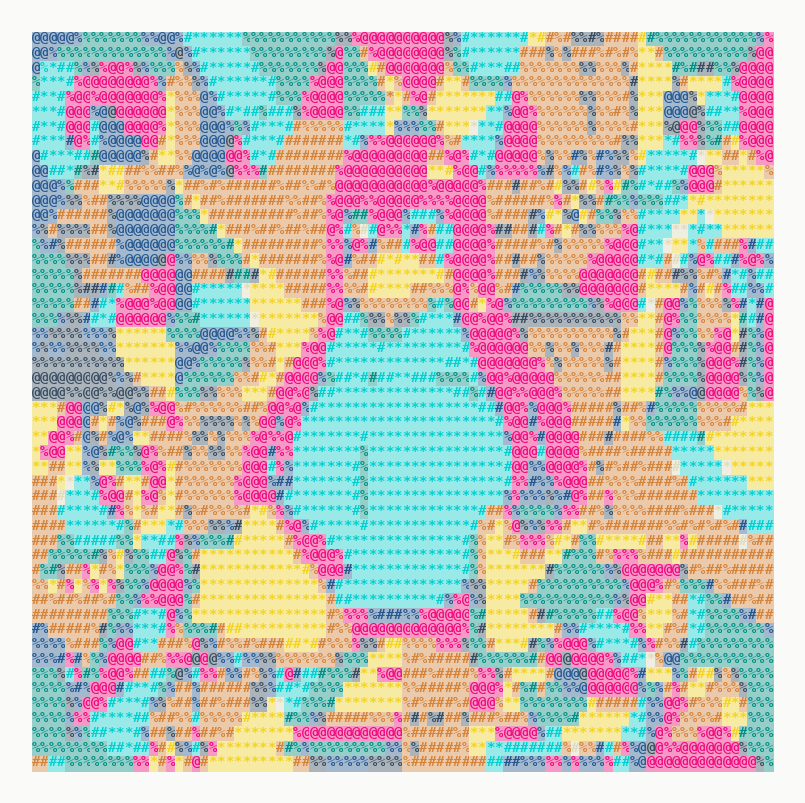

  <a href="https://pizofh.com"><strong>Portfolio</strong></a>
  &nbsp; · &nbsp;
  <a href="https://gitlab.com/Pizofh"><strong>GitLab</strong></a>
  &nbsp; · &nbsp;
  <a href="https://www.linkedin.com/in/steve-garnica/"><strong>LinkedIn</strong></a>
  &nbsp; · &nbsp;
  <a href="#selected-work"><strong>Projects</strong></a>

### I work where application code meets infrastructure.

I build backend services, automate deployments, and work with Linux systems. My experience combines enterprise operations in restricted environments with hands-on projects in cloud infrastructure, delivery pipelines, and observability.

**My focus:** repeatable deployments, useful operational signals, and automation that stays maintainable.

## Selected work

| Project | What I built |
| :--- | :--- |
| **[SimOps](https://github.com/Pizofh/SimOps)** Observability & operations | A multi-service lab for simulating operational failures, investigating application metrics and logs, and practicing recovery. AWS EC2 · FastAPI · PostgreSQL · Docker Compose · Prometheus · Grafana · Loki |
| **[SuperQTAS](https://github.com/Pizofh/SuperQtas)** Business automation & releases | A lightweight ERP in Google Sheets, with separate QA and production environments, automated checks, and controlled releases. Apps Script · JavaScript · clasp · GitHub Actions |
| **[JobOps](https://github.com/Pizofh/JobOps)** Workflow automation | A system for organizing job alerts, prioritizing opportunities, and tracking applications with testable JavaScript logic. JavaScript · Apps Script · Google Sheets · Node.js |
| **[InfraLens](https://github.com/Pizofh/InfraLens)** Linux troubleshooting | A local CLI for collecting focused system evidence into versioned JSON snapshots, with visibility into partial collection results. Python · Linux · JSON · CLI |
| **[Doomed](https://github.com/Pizofh/Doomed---Doom-for-Redmi-watch-4-)** Native systems project | A playable DOOM II port for Redmi Watch 4 stock firmware, using a native C engine and a Lua/LVGL interface. Offline installation tooling exists, but the public installer and second-owner setup are not yet validated. C · Lua · LVGL · Device integration · Offline CI |

Projects have different maturity levels. Doomed's confirmed gameplay is on one tested device/firmware; see each repository for validation scope and limitations.

## How I work

- **Automate repeatable work.** Bash, Ansible, and CI/CD workflows for consistent operations and releases.
- **Make systems observable.** Metrics, logs, dashboards, and health checks for troubleshooting.
- **Keep changes controlled.** Environment separation, validation, documented operational decisions.

## Toolbox

| Area | Tools |
| :--- | :--- |
| Infrastructure & automation | Linux / RHEL / Ubuntu · AWS · Terraform · Ansible · Bash |
| Containers & delivery | Docker · Docker Compose · GitHub Actions · GitLab CI/CD |
| Observability | Prometheus · Grafana · Loki · CloudWatch |
| Backend & data | Python · FastAPI · Django · PostgreSQL |
| Web operations | Nginx · DNS · HTTPS/TLS · Cloudflare |

---

Based in **Bogotá, Colombia** · Spanish native · English B2 (Cambridge FCE)

Interested in **DevOps, Platform Engineering, Site Reliability Engineering, troubleshooting, cloud operations, and reliable software delivery**.

[Explore my portfolio →](https://pizofh.com) · [GitLab projects →](https://gitlab.com/Pizofh)

  

